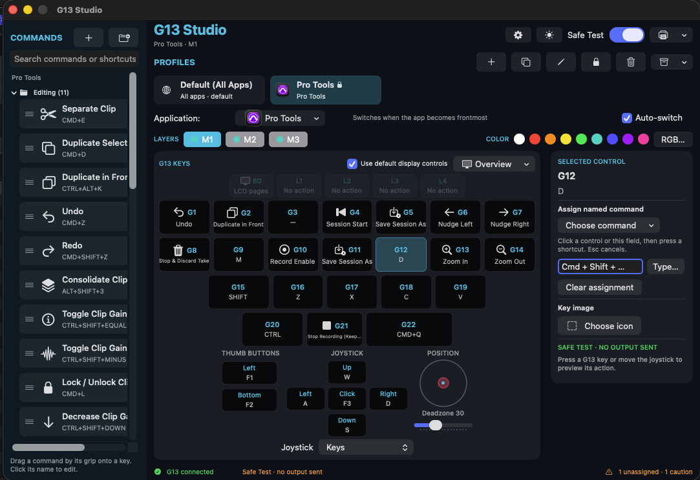
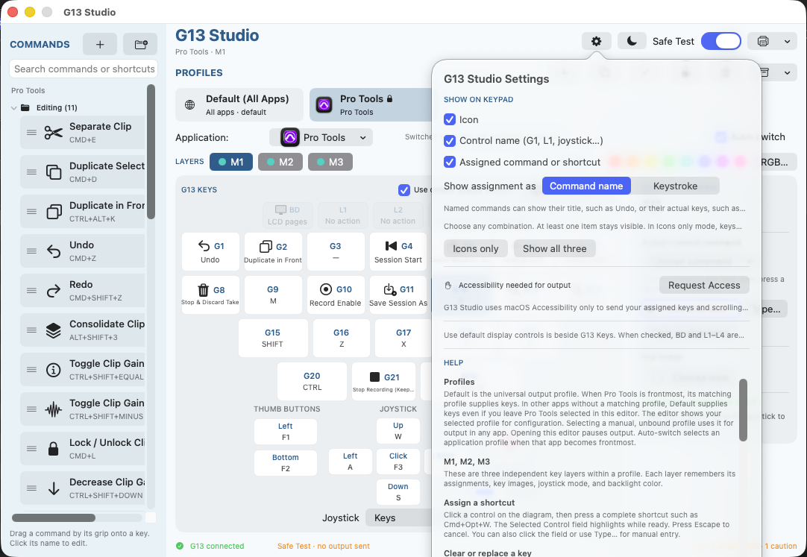
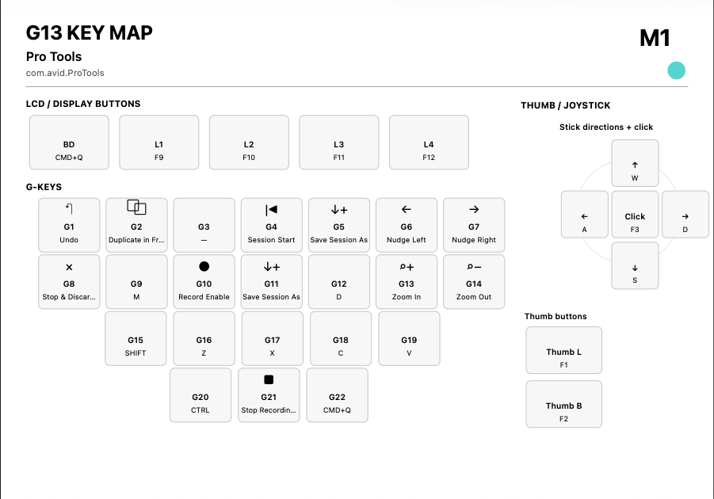

# G13 Studio

G13 Studio is a native macOS menu bar app for the Logitech G13 gameboard. It is built on [Bertrand Mansion's original G13 project](https://github.com/golgote/G13). Thank you to Bertrand for making a modern macOS G13 driver available as open source. The original MIT [LICENSE](LICENSE) and copyright notice are retained.

This contribution expands the original key mapper into a profile editor for application shortcuts, including workflows in Avid Pro Tools. It uses SwiftUI, AppKit, IOKit HID, and CoreGraphics, with no third-party packages, network communication, or telemetry.

## Screenshots

### Main screen — dark mode

### Settings — light mode

### PDF key map preview

## What this contribution adds

- A keypad diagram with larger G-key tiles, thumb buttons, joystick directions, selected-control editing, hover descriptions, and right-click assignment menus.
- A universal **Default (All Apps)** profile plus application-specific profiles. Profiles can activate when their application comes to the front, be duplicated, renamed, deleted with confirmation, and backed up or restored. The editor can remain on a selected profile while output follows the frontmost application.
- **M1, M2, and M3 as three layers within each profile**, rather than the first three profiles. Each layer keeps its key assignments, key images, joystick mode, and backlight color.
- Named **Keystroke** and **Multi Key** commands with an in-app shortcut recorder, searchable command list, application-scoped folders, and drag-and-drop assignment to controls or movement between folders.
- A starter library of Pro Tools shortcuts and symbols. Check every shortcut against your Pro Tools version and keyboard layout before using it in a session.
- Built-in and imported PNG/JPEG icons for commands and keys. Settings can show any combination of icon, control label, and assignment. Assignment text can show a command name such as **Undo** or its actual keys such as **CMD+Z**. Keys without icons show text in Icons only mode.
- G13 LCD pages for Overview, a selectable profile list, and approximate CPU/RAM usage. With **Use default display controls** checked, BD cycles pages; L1/L2 navigate profiles and L3 saves the startup profile on the Profiles page. Uncheck it to use saved BD/L shortcuts. The assignments are preserved while display controls are active.
- Joystick key mode or vertical, horizontal, or both-axis scrolling. In single-axis scroll modes, the other axis can still send keys. Scrolling directions are dimmed in the editor, and vertical and horizontal speeds are separate per profile.
- **Safe Test**, enabled at each launch, previews actions without sending synthetic keys or scrolling. Held keys and scrolling are released on disconnect, profile changes, and output pause. Warnings flag unassigned keys and potentially destructive assignments.
- Portrait or landscape PDF key maps for all three layers of a profile.

## Requirements and build

- macOS 14.6 or later, full Xcode, and a Logitech G13 for hardware input and LCD/backlight output.
- macOS Accessibility permission is needed only to send assigned keystrokes and scrolling. Choose **Request Access** in Settings when ready. Safe Test needs no Accessibility grant.

Open `G13.xcodeproj`, select the **G13** scheme, and choose **Product → Build** (Cmd-B). The app appears as **G13 Studio**. The project has no required Apple developer team; a distributing organization can apply its own signing and notarization. This source and the locally shared app are not notarized.

The bundle identifier remains `com.openg13.G13` so existing profiles in the current Mac account can be read. Quit an older running G13 build before replacing it. Profiles and commands are saved locally for the Mac account; imported icons are stored in Application Support. G13 onboard profile storage is not supported.

## Getting started

1. Build and open G13 Studio. Leave **Safe Test** on while checking your mappings.
2. Create or select a profile. **Default (All Apps)** supplies output when the frontmost app has no matching profile. Bind an application profile to an installed app to enable automatic activation; choose its **Auto-switch** setting as needed.
3. Press M1, M2, or M3 to edit that profile's layer. Click a control and press a shortcut, choose a named command, or drag a command from the Commands list. Use the color controls to set the layer backlight.
4. Use **+** in Commands to record one Keystroke or a Multi Key sequence. The physical MR button opens the same command editor with Multi Key selected. Commands in **All Apps** are available to every profile; application commands appear in their matching profile.
5. In Settings, choose which details appear on the keypad and whether assignment text uses command names or keystrokes. Choose joystick mode and, for scrolling, the applicable axis speeds.
6. When ready for live output, request Accessibility access in Settings and turn Safe Test off. Start with a disposable document or Pro Tools session.

Opening the editor pauses live output so shortcuts do not enter the editor. Safe Test previews the selected profile there. Away from the editor, the status row identifies the output profile. A manually selected unbound profile can supply output in any application until the frontmost app changes.

## Screen and controls

**Use default display controls** is beside G13 Keys and starts checked. BD cycles Overview, Profiles, and CPU/RAM. Overview shows the output profile and M layer. Profiles shows a list with up, down, and lock icons above L1–L3. L1/L2 cycle profiles; L3 saves the startup choice. L4 has no LCD action. The L buttons have no LCD action on Overview or CPU/RAM. While checked, BD/L tiles and assignment editors are dimmed and disabled; unchecking restores their saved shortcuts.

The joystick's deadzone sets how far it moves before a key or scroll action begins. Vertical scroll reserves Up/Down and leaves Left/Right programmable; horizontal scroll does the reverse; both-axis scroll reserves all four directions. Thumb buttons and stick click remain independently programmable. Centering the stick, disconnecting the device, or changing profiles stops scrolling.

## Safety and architecture

The app matches the G13 by USB vendor ID `0x046D` and product ID `0xC21C` through `IOHIDManager`. Eight-byte input reports carry keys and joystick position. HID output and feature reports update the 160×43 LCD, RGB backlight, and M-key LEDs. `CGEvent` sends assigned macOS keyboard and scroll events after Accessibility permission is granted. No kernel extension, administrator privilege, external service, or shell command is required at runtime.

The USB input buffer remains owned until callbacks are unregistered. The mapper tracks key-down actions so key-up uses the same mapping, even if a profile changes. The `tests/` directory contains focused checks for key release, macro cancellation, profile persistence, backup/restore, shortcut capture, display pages, drag payloads, icons, and PDF layout. These checks complement testing with a physical G13 and the target application.

## Contributing upstream

Fork [golgote/G13](https://github.com/golgote/G13), create a feature branch from the current upstream default branch, copy this source into the fork's repository root, commit, push, and open a pull request. The pull request should describe the behavior, tests, and any remaining hardware limitations. Do not include built `.app` bundles, local profiles, or Xcode `xcuserdata` in the pull request.

## Credits and license

Thank you to **Bertrand Mansion ([@golgote](https://github.com/golgote))** for the original G13 macOS project and for welcoming contributions. The original project credits [tewhalen/g13slop](https://github.com/tewhalen/g13slop), [ecraven/g13](https://github.com/ecraven/g13), [bjanders/g13](https://github.com/bjanders/g13), and [jtgans/g13gui](https://github.com/jtgans/g13gui) for USB protocol work.

The G13 Studio features were designed, directed, and tested by **[@chrisclick](https://github.com/chrisclick)**. The implementation was developed with **OpenAI Codex** under that direction and review.

Distributed under the MIT [LICENSE](LICENSE). Copyright (c) 2026 Bertrand Mansion for the original project.
